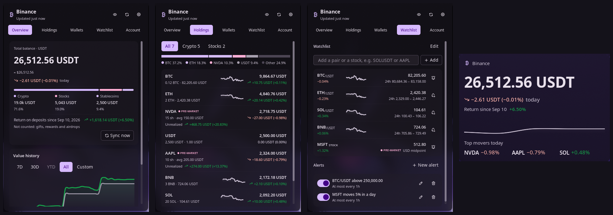

# Binance

Binance shows your Binance portfolio in the Noctalia bar: total value, today's change, your Binance Stocks shares,
and the return on what you deposited. Without a key it is a watchlist with price alerts and a `/bn` price lookup.

Account data comes from a read-only API key. The plugin generates the key pair itself, keeps the private half in your
system keyring and refuses any key with a trading, transfer or withdrawal permission that Binance reports. Binance
doesn't report Stocks trading, so keep that off yourself.



## Plugin

| Field | Value |
| --- | --- |
| ID | `ayagmar/binance` |
| Entries | Bar widget: `bar`; desktop widget: `desktop`; panel: `panel`; service: `service`; launcher provider: `launcher` |
| Launcher Prefix | `/bn` |

## Requirements

Prices, the watchlist, alerts and `/bn` need nothing beyond Noctalia. Connecting an account needs:

- `python3` with the `cryptography` module, which signs requests with the Ed25519 key. On Arch:
  `sudo pacman -S python-cryptography`.
- `secret-tool` (from libsecret) and a running Secret Service keyring such as gnome-keyring or KWallet. The private
  key and the API key live there.
- `wl-paste` and `wl-copy` (from wl-clipboard). The helper reads the API key from the clipboard and then clears it.
- `xdg-open`, optional, opens Binance API Management from the wizard. Without it the wizard copies the URL instead.

Only Binance.com accounts are supported. Binance.US, Binance TR and other regional exchanges use other hosts and are
not contacted.

## Usage

### Show it in your bar

Plugins can't put themselves on the bar; where widgets go is part of your bar configuration. Open Settings → Bar,
add a widget and pick **Binance**. The connect wizard reminds you of this when it finishes.

### Bar

Without a key the widget shows a watchlist ticker; scroll to step through the pairs. Once connected it shows your total
and today's change. The widget's own settings (Settings → Bar, then the Binance widget) choose what it shows:

- **Total value** (default): the total and today's change in percent.
- **Today's P&L**: today's change as an amount and a percentage.
- **An asset's price**: the first entry of **Assets**, a watchlist pair such as `ETHBTC`, a coin from the watchlist
  such as `BTC`, or a holding such as `NVDA`, with its 24h or today's change.
- **Cycle through them**: the total, today's P&L, then each asset, one every **Seconds per view** (10 by default).
  Scroll to step through them by hand.

Without a key there is no total, so only the watchlist pairs among your assets show; with none, the bar falls back to
the watchlist ticker. Under the privacy mask the total and the P&L amount are hidden; percentages and prices stay.

| Action | What it does |
| --- | --- |
| Left click | Opens the panel. |
| Right click | Switches the style: with the change, without it, or icon only. |
| Middle click | Refreshes now (`plugin ayagmar/binance:service all refresh`; rebind it in the widget's settings). |
| Scroll | In cycle mode, steps through the views. Without a key, steps through the watchlist. |
| Hover | Total, today's change, the crypto and stocks split, and when data was last updated, whatever the bar shows. |

### Panel

```sh
noctalia msg panel-toggle ayagmar/binance:panel
```

- **Overview.** Total balance, today's change, its split into crypto, stocks, stablecoins and cash (percentages stay
  visible under the privacy mask), the return on deposits, and a value chart with 7D, 30D, YTD, All and custom
  ranges. Ranges unlock as the plugin's daily history fills. With a target allocation set, a card shows each class
  against its target and plans your next deposit (see [Target allocation](#target-allocation)).
- **Holdings.** Every asset with quantity, value and 24h change. Stocks show shares, average cost, unrealized and
  realized P&L; coins show the same once their cost basis is known (see [Crypto cost basis](#crypto-cost-basis)). Small
  balances are folded away. Click a holding to open it on binance.com: a coin opens its USDT market (USDT its price
  page), a stock its Binance Stocks page. Without `xdg-open` the click copies the link.
- **Wallets.** Spot, Funding, Earn and the other Binance wallets, plus a Stocks wallet.
- **Export CSV** (bottom of Holdings). Saves `binance-portfolio-YYYY-MM-DD.csv` in your downloads folder
  (`XDG_DOWNLOAD_DIR`, else `~/Downloads`). It always creates a new file, readable only by you (mode 600), and never
  writes over an existing file or through a symlink: a second export that day gets `-2`, then `-3`. It holds every
  holding (kind, asset, quantity, price, value, and average cost, cost and unrealized P&L where known) and the return on
  deposits since your first deposit plus the range picked on Overview, all in the display currency. The export needs the
  helper (it creates the file), so it works once an account is connected. A coin without a cost basis has empty cost
  cells. Amounts are written even with **Hide amounts** on. A notification names the file and the panel offers **Open**,
  which hands it to `xdg-open`. Text cells that a spreadsheet would read as a formula start with an apostrophe.
- **Watchlist.** Pairs and stocks to follow, with price alerts: price above, price below, or a 24h move of at least
  some percent. Each alert sends a notification, then waits for its cooldown before it fires again.
- **Account.** The connect wizard, the verified badge, key rotation, disconnect, the privacy mask and the bar mode.

### Stocks in the watchlist

Type a ticker such as `AAPL` in the watchlist's add field. Anything that isn't a crypto pair is checked against the
tickers Binance Stocks lists. Stock prices are the bid/ask midpoint in USD, refreshed every minute while the panel is
open and every 3 minutes otherwise. Binance only answers stock quotes for a key, so stock rows need a connected account;
without one the row says so. The change shown is against the last quote of the previous UTC day the plugin saw, so it
appears from the second day you watch a ticker. If that quote is older than the previous trading day (the plugin didn't
run in between), no change is shown and percentage alerts wait for a fresh base. Stocks have no sparkline, since
Binance has no stock price history.

Stock rows in Holdings and the watchlist carry the US market session on Binance Stocks, in New York time: pre-market
(04:00 to 09:30), open (09:30 to 16:00), after hours (16:00 to 20:00), overnight (20:00 to 04:00, only for tickers
Binance trades overnight) or closed (weekends and NYSE holidays). Tickers Binance doesn't trade in extended hours have
no pre-market or after hours. The plugin reads which tickers trade when from Binance's stock list once a day. On the
13:00 early closes after Thanksgiving and on Christmas Eve, after hours is taken to end at 17:00. Outside trading the
watchlist dims the price and shows when the last quote came in, and quotes are fetched every 30 minutes instead of
every few. Binance has no market phase in its REST API, so the session comes from the clock and a holiday table for
2026 and 2027; later years count every weekday until the plugin is updated. Without the system's time-zone data for
New York (tzdata), no session is shown.

Price alerts work on stocks too. They are checked against each new stock quote, so they need a connected account,
and a stock alert keeps its ticker quoted even after you remove it from the watchlist.

Percentage alerts ("moves at least 5%") compare against the 24h change for crypto and the day change for stocks, in
either direction. A stock's percentage alert can only fire once a previous day's quote is known.

### Desktop widget

A portfolio card for the wallpaper. Add it from the desktop-widgets editor (Settings → Desktop → Toggle Editor), where
**Binance** appears in the type picker once the plugin is enabled. It shows the total with today's change, the return
for the range picked in the panel's Overview (the return on deposits until you pick one), a 7-day value sparkline and
today's three biggest movers among your holdings, stablecoins left out. Click it to open the panel.

Without a key it says so and offers **Open Binance**. During the first sync it says it is fetching; when data is stale
it dims and says when it last updated; an error that stops account data shows in its corner. The privacy mask hides
the amounts and keeps the percentages. The currency is the plugin's `display_currency`.

Without a box the card is 480 px wide (**Large**) or 260 px (**Small**, which shows only the total, today's change
and the return), and as tall as what it has to show: the sparkline waits for two days of history and the movers for
today's prices. Noctalia doesn't tell plugin widgets their box size; with `box_width` and `box_height` set, it scales
the card evenly to fit and centres it. The card fills the box width when the box is at least as tall, in proportion,
as the card. With either left at `0.0` the card keeps its own size.

### Launcher

Type `/bn` followed by a coin or pair, such as `/bn sol` or `/bn ETHUSDT`. Results show the price, the 24h change and
range. Enter copies the price of a watched pair, or adds an unwatched pair to the watchlist. With an account connected,
`/bn` alone lists your portfolio summary first, and your holdings match by name.

### Connect a read-only key

Open the panel, go to **Account** and click **Connect read-only key**. It takes about two minutes:

1. **Generate key.** The helper creates an Ed25519 key pair. The private key goes into your keyring and never leaves
   this computer. The public key is copied to your clipboard.
2. **Register it on Binance.** Open API Management, click Create API and choose Self-generated. Paste the public key
   and leave only Enable Reading ticked. Restricting the key to your IP is fine.
3. **Save API key from clipboard.** Copy the API Key Binance shows you and click the button. The helper reads it from
   the clipboard, stores it in the keyring and clears the clipboard. Noctalia's clipboard history or cliphist may still
   hold a copy; delete that entry yourself. The plugin doesn't touch your clipboard history.
4. **Verify.** The helper asks Binance what the key may do. If anything besides reading is on, it names the toggles to
   untick, and you click Verify again with the same key.

**Rotate key** runs the same steps; the old key keeps working until the new one passes. **Disconnect** removes both
keys from the keyring and deletes the cached account data. Delete the key in Binance API Management too, since the
plugin can't.

### Return on deposits

The Overview shows your value minus everything you put in plus everything you took out, each valued at the time it
happened. The first sync reads your whole history and takes a few minutes; **Sync now** starts it again. After that,
crypto deposits are checked with every balance refresh (every 5 minutes) and the other sources every hour.

Counted:

- crypto deposits and withdrawals, including internal transfers by email or phone,
- bank deposits and withdrawals,
- card purchases (not those paid from your fiat balance, which the bank deposit already counts),
- P2P trades from the last 6 months and Binance Pay from the last 18 months, as far back as Binance keeps them.

Not counted: gifts, rewards and airdrops. If your account is older than the P2P or Pay limit, the Overview says so
under the return. A source Binance refuses is named the same way and retried on the next sync.

A flow with no price from its time, such as a coin that had no USDT pair yet, is left out and named under the return.
If such flows add up to more than 1% of your deposits, the return shows as not available instead. In EUR this covers
everything before EURUSDT listed in January 2020, which no rate from that time can convert.

Date ranges subtract the flows inside them once every source covers the range. Until then they show a market return,
which is price moves only and labelled as such.

### Crypto cost basis

Binance doesn't keep what you paid for a coin, so the plugin works it out. Every hour, once your deposit history is
synced, it reads your spot trades for each coin you hold against USDT, USDC, FDUSD, BTC, ETH, BNB and EUR, and replays
them in order with your deposits and withdrawals:

- a buy adds what you paid, fees included, and a deposit adds its value when it arrived;
- a sell, or a trade that paid with the coin, removes cost at the running average and counts as realized P&L;
- a withdrawal removes cost at the average without a result.

The first read can take a few minutes on an account with many trades; after that only new trades are read. Prices of
BTC, ETH, BNB and EUR at trade time come from public hourly candles.

Your wallet amount is what gets valued. When the replay doesn't add up to it by more than 1%, the average is marked
**≈** and its tooltip says why: Earn rewards, Convert trades, airdrops, gifts, and coins bought by card, Buy Crypto or
P2P in euros aren't in the history. Every average is also marked **≈** until your deposit and withdrawal history is fully
synced; a history source Binance doesn't offer your account doesn't hold it back. A coin the history never shows coming
in has no cost basis.

Pairs are found from the coins you hold now. If you spent BTC on a coin you've since sold entirely, and the plugin
never read that pair while you held the coin, that trade is missing from BTC's replay and its average shows as **≈**.

### Target allocation

Turn on **Target allocation** in the plugin settings and give each asset class a weight: crypto, stocks, stablecoins
and cash. Weights are relative, so 6, 3 and 1 mean the same as 60, 30 and 10. The Overview then lists each class with
its share and target, and marks the ones more than the drift band away (5 points by default) as over or under.

To target a single holding, click **Target a holding** on the card, pick it and enter its share of the whole portfolio,
such as 20% for NVDA. It shows under its class with its own share, target and status, and on its Holdings row. Click
the row to change or remove it. The rest of the class shares whatever the class target leaves: with stocks at 60% and
NVDA at 20%, your other stocks aim for 40%. The card warns when a class's holding targets add up to more than the
class target. To use holding targets alone, set every class weight to 0.

Type an amount under **Next deposit** and the card splits it across the classes and holdings below target, in
proportion to how far each is short once the money is added, such as "300 NVDA, 300 other stocks, 400 crypto". A
holding's line also shows about how many shares or coins that buys at today's price. A class with weight 0 is only
listed once it drifts past the band, so stablecoins you don't target stay out of the way. It only suggests buys: nothing is sold, and the plugin never places an
order.

With **Notify on drift** on, a class or targeted holding that leaves the band sends one notification. It notifies again
only after it has come back well inside the band (within 80% of it), and it waits until balances, stocks and prices have all loaded, so a sync in
progress can't trigger it.

## Settings

| Setting | Type | Default | Description |
| --- | --- | --- | --- |
| `display_currency` | `select` | `USDT` | `USDT` or `EUR` for totals, holdings and P&L. In EUR, deposits, withdrawals and the history chart use the rate of their own day; current values, stock cost, realized P&L and today's change use today's rate. USDT totals also show an approximate dollar figure. |
| `day_boundary` | `select` | `utc` | When "today" starts for today's change: midnight UTC (`utc`, what Binance uses) or your local midnight (`local`). The history chart always uses UTC days. |
| `daily_summary` | `bool` | `false` | Sends one notification a day with your total, today's change and the biggest mover (the holding worth at least 1% of the portfolio that moved most). With **Hide amounts** on it names percentages only. Needs a connected account. |
| `daily_summary_time` | `string` | `20:00` | Local time for the daily summary, as `HH:MM` in 24-hour format. If balances or prices are more than 15 minutes old then, the summary waits for the next refresh and skips the day if none comes before midnight. A summary already sent today is not sent again after a restart. |
| `targets_enabled` | `bool` | `false` | Turns on the target allocation card and drift notifications. |
| `target_crypto`, `target_stocks`, `target_stable`, `target_other` | `int` | `60`, `30`, `10`, `0` | Relative weight of each class, 0 to 100. `other` is cash (fiat balances). Weights are normalized, so they need not add up to 100. |
| `drift_band` | `int` | `5` | Percentage points a class can move from its target before it counts as off target. |
| `drift_notify` | `bool` | `true` | Notifies once when a class or targeted holding leaves the band. |

The bar widget has its own settings, under Settings → Bar on the Binance widget:

| Setting | Type | Default | Description |
| --- | --- | --- | --- |
| `show` | `select` | `total` | `total`, `today` (today's P&L), `price` (the first of `assets`) or `cycle` (total, today, then each asset). |
| `assets` | `string_list` | `["BTC"]` | Watchlist pairs, watchlist coins or holdings, such as `ETHBTC`, `BTC` or `NVDA`. Shown with `price` and `cycle`. |
| `cycle_seconds` | `int` | `10` | Seconds per view while cycling, 3 to 300. |

The desktop widget's settings, in the desktop-widgets editor:

| Setting | Type | Default | Description |
| --- | --- | --- | --- |
| `size` | `select` | `large` | `large` (480 px wide) or `small` (260 px wide; total, today and the return only). |
| `show_sparkline` | `bool` | `true` | The 7-day value sparkline. Large only. |
| `show_movers` | `bool` | `true` | Today's top three movers. Large only. |

The privacy mask and the bar style (value and change, value only, icon only) are set from the panel's Account tab.

## IPC

```sh
# Refresh prices, balances and stocks now
noctalia msg plugin ayagmar/binance:service all refresh

# Log a one-line status summary (no amounts) to Noctalia's log
noctalia msg plugin ayagmar/binance:service all status

# Hide or show amounts everywhere (bind privacy-toggle to a key)
noctalia msg plugin ayagmar/binance:service all privacy-toggle   # or privacy-on / privacy-off
```

## Notes

- **Read-only by design.** Verify reads the key's permissions from Binance and accepts it only if reading is on and
  every other `enable…` or `permits…` flag is off. A permission Binance adds later is refused until the plugin knows it.
  The check runs again every day on the key in use, even while a rotation is unfinished, and before anything else after
  a restart when the last one is a day old or failed. Only clicking Verify switches to a new key.
  If it fails, account data stops refreshing, manual refreshes included, and the plugin checks again every hour until
  the key passes. Binance doesn't report the Stocks trading permission, so keep that off in API Management.
- **One process holds the keys.** `binance_helper.py` is the only code that reads the keyring or signs a request. The
  API key goes from the clipboard to the keyring inside the helper; it never reaches the plugin's Luau code, a command
  line, a log or a file. With an Ed25519 key, the API key alone can't sign anything.
- **Privacy mask.** **Hide amounts** in the Account tab masks balances and quantities in the bar, its tooltip, the
  panel and `/bn`. Percentages stay visible.
- **Network.** Two hosts, both over HTTPS:
  - `data-api.binance.vision`: public prices, 24h tickers and daily candles, fetched by the service without a key,
    every 30 seconds while the panel is open and every 60 seconds otherwise.
  - `api.binance.com`: the helper's signed reads (wallet balances, Stocks orders, deposit and withdrawal history, key
    permissions) and public server time, hourly candles, the Binance Stocks ticker list (daily) and stock quotes. The
    helper follows no redirects and talks to no other host.
- **Rate limits.** A 429 from Binance pauses requests for at least 60 seconds, or longer if Binance says so; on the
  public price host the pause doubles while 429s repeat. A 418 pauses everything for at least 10 minutes. The panel shows when requests resume. Pauses are saved, so reloading the plugin
  doesn't skip them.
- **Files written.** All in the plugin's data folder (`~/.local/state/noctalia/plugins/data/ayagmar/binance/`), which
  the helper keeps at mode 0700. They hold prices, quantities, deposits and settings, never keys: `prefs.json`,
  `prices.json`, `history-cache.json`, `account.json`, `balances.json`, `ledger.json`, `marks.json`, `stocks.json`,
  `stock-orders.json`, `stock-orders.json.partial` (while a stocks sync is unfinished), `tokenized-assets.json`,
  `flows.json`, `flows-daily.json`, `stock-quotes.json`, `equity-symbols.json`, `cursors.json`, `clock.json`,
  `trades.json`, `crypto-costs.json`, `ratelimit-public.json`, `ratelimit-signed.json`, `helper.lock` and `ledger.lock`, plus `export.csv` and
  `export-request.json` for the moment an export is handed to the helper. The only file written elsewhere is the CSV
  that **Export CSV** saves in your downloads folder. Files are written through a `.tmp-…` file and
  renamed; a helper stopped mid-write can leave one behind, and **Disconnect** removes those too.
- **Processes.** Each runs from an argument list, never through a shell:
  - `python3 -I binance_helper.py <command> --data-dir <data folder>`, only once you start connecting an account.
  - `secret-tool store|lookup|search|clear service noctalia-binance key <name> slot <pending|active>`, run by the helper.
  - `wl-paste --no-newline` and `wl-copy --clear` (each also with `--primary`), run by the helper when you save the API
    key.
  - `xdg-open https://www.binance.com/en/my/settings/api-management`, when you click Open API Management.
  - `xdg-open` with `https://www.binance.com/en/trade/<COIN>_USDT`, `…/en/price/tether` or
    `…/en/stocks/EQ_<TICKER>`, when you click a holding.
    Only symbols of 1 to 20 capital letters and digits get a link.
  - `xdg-open <exported file>`, when you click Open after an export.
- **Known limits.** Stock dividends, splits and other corporate actions aren't tracked; if your order history no longer
  adds up to the shares in your wallet, the wallet count wins and the average cost is marked approximate. Stock values
  use the bid/ask midpoint, and the last quote while the market is closed. Stock history starts at the plugin's first
  quote, since Binance has no stock price history.

### Troubleshooting

- **Keyring locked.** Account data pauses and the panel shows *Keyring locked*. Unlock the keyring and click
  **Retry**. Prices keep updating meanwhile.
- **No keyring service found.** Install and start one, such as `sudo pacman -S gnome-keyring`, or use KWallet, then
  log in again.
- **python-cryptography is not installed.** Run `sudo pacman -S python-cryptography`, then click **Verify now** in
  the Account tab.
- **Binance rejected the key.** Check that it still exists in API Management and, if it is restricted to an IP, that
  your current IP is allowed.
- **Clock is off.** Binance rejects signed requests from a clock more than a few seconds wrong. Turn on time sync with
  `timedatectl set-ntp true`.
