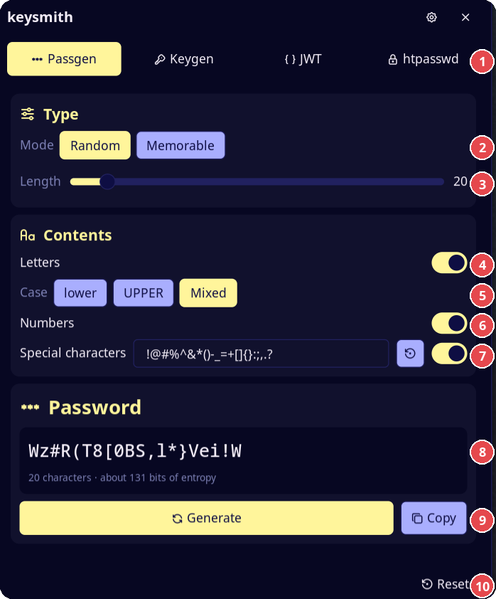
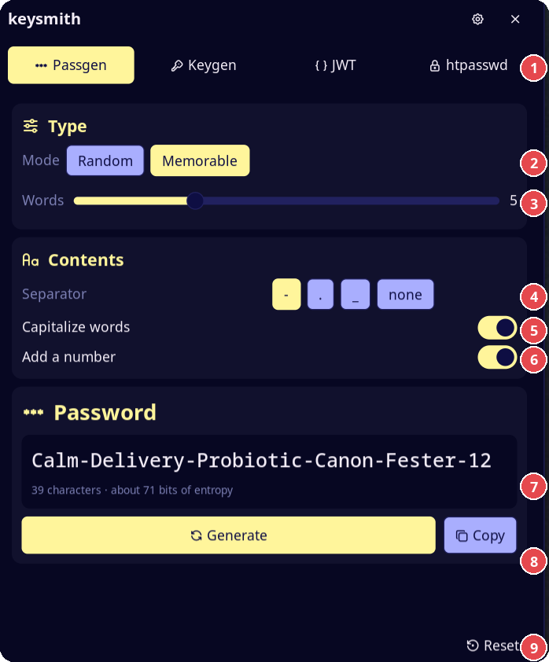
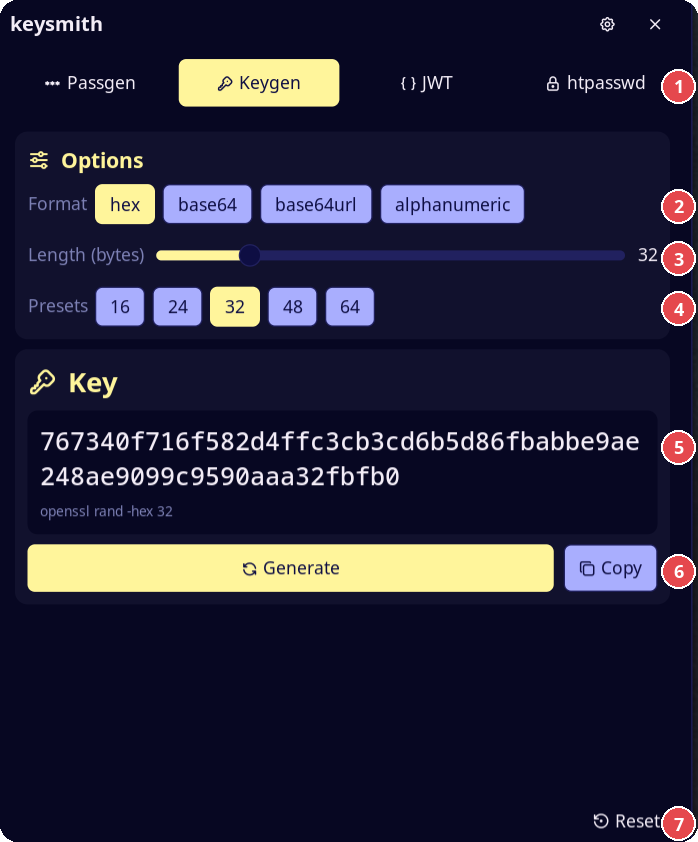
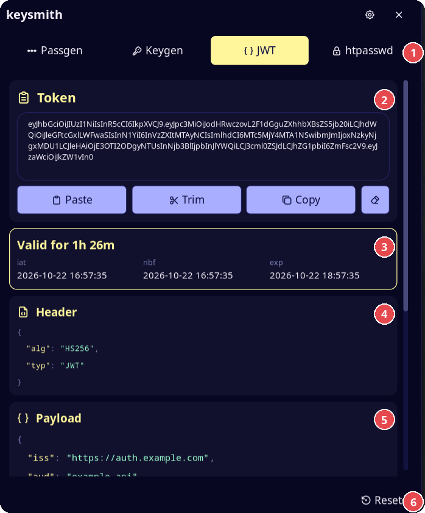
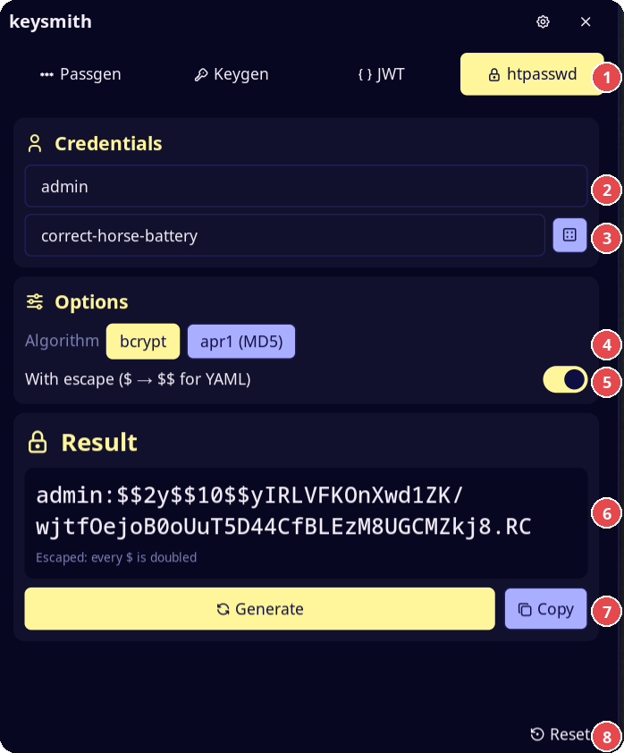

# keysmith

Generate passwords, keys and htpasswd lines, and decode JWTs, from the bar.
Click the glyph to open a panel with four tabs. Secrets are never written to
disk: results and pasted tokens stay in memory and are wiped when the panel
closes. Only the special characters list and the last tab are saved.

## Plugin

| Field | Value |
| --- | --- |
| ID | `nightwatch75/keysmith` |
| Entries | Bar widget: `keysmith`; panel: `panel` |

## Requirements

- noctalia v5.0.1 or newer (`plugin_api = 24`). The plugin needs direct
  argument lists for commands, which arrived with API 24.
- `openssl` for the `hex`, `base64` and `base64url` formats of the Keygen tab.
- `htpasswd` (Apache utils: `apache2-utils`, `httpd-tools`) for the htpasswd tab.
- `od` (coreutils) to read random bytes from `/dev/urandom`.
- `mkfifo` (coreutils) to pass the htpasswd password to `htpasswd` without putting it in the command arguments.
- A monospace font: the results use the system `monospace` alias.

## Usage

Add **keysmith** to a bar from the Add-widget picker and click it, or:

```sh
noctalia msg panel-toggle nightwatch75/keysmith:panel
```

### Passgen



1. Tabs: Passgen, Keygen, JWT and htpasswd.
2. Mode: Random or Memorable.
3. Length of the password, from 8 to 128.
4. Letters on or off.
5. Case of the letters: lower, UPPER or Mixed.
6. Numbers on or off.
7. Special characters on or off. The field lists the characters the generator
   can use. The restore button brings back the default list.
8. The new password and the estimated entropy.
9. Generate makes a new password. Copy puts it on the clipboard.
10. Reset puts the options of the open tab back to their defaults.

- **Random**: length (8–128), letters with lower / upper / mixed case,
  numbers, special characters. Each enabled set is always present.
  With special characters on, a field lists the characters Passgen may use
  (default `!@#%^&*()-_=+[]{}:;,.?`). Remove the characters you do not want
  or add others, for example `$`. The field is saved in the plugin data folder; the restore
  button brings back the default.
- **Memorable**: a passphrase of 3–10 words from the
  [EFF large wordlist](https://www.eff.org/deeplinks/2016/07/new-wordlists-random-passphrases)
  (7776 words, about 12.9 bits per word). Options: separator, capitalized
  words, a number at the end. Five words give about 65 bits.

The panel shows the estimated entropy of each result.



In Memorable mode, items 3 to 6 change: 3 is the number of words, 4 the
separator (`-`, `.`, `_` or none), 5 capitalizes each word, and 6 adds a
two-digit number at the end.

### Keygen



1. Tabs.
2. Format: `hex`, `base64`, `base64url` or `alphanumeric`.
3. Length, in bytes (in characters for `alphanumeric`).
4. Presets for the length: 16, 24, 32, 48 and 64.
5. The new key and the command that made it.
6. Generate and Copy.
7. Reset.

Runs `openssl rand` for `hex`, `base64` and `base64url` (no padding). The
panel shows the equivalent command, for example `openssl rand -hex 32`.
`alphanumeric` does not use `openssl`: it takes the same `/dev/urandom` bytes
as Passgen. The length is in bytes, or in characters for `alphanumeric`.

### JWT



1. Tabs.
2. The token field. Under it: Paste, Trim, Copy and Clear.
3. Validity of the token, and the `iat`, `nbf` and `exp` dates.
4. Header, as indented JSON.
5. Payload, as indented JSON. The signature is below it.
6. Reset.

Decodes a JSON Web Token. It does not check the signature.

- **Paste** reads the token from the clipboard.
- **Trim** keeps only the token and removes text around it: quotes, JSON
  fragments, `Bearer `. The decoder also ignores that text, so Trim only
  cleans the field.
- The header and the payload show as indented JSON in separate boxes, with
  the key order of the token. Long values continue on the next line. A highlighted box above the JSON tells you if the token is
  expired or how long it stays valid, and lists `iat`, `nbf` and `exp` as
  dates.
- Keys, strings, numbers and punctuation have different colors.
- **Copy** puts the decoded header and payload on the clipboard as one JSON
  document: `{ "header": …, "payload": … }`.
- The signature shows as plain text, below the payload.
- **Clear** empties the field. The field also clears when the panel closes.

### htpasswd



1. Tabs.
2. User name.
3. Password. The dice button fills the field with 24 random characters.
4. Algorithm: `bcrypt` or `apr1`.
5. With escape: doubles every `$`.
6. The `user:hash` line.
7. Generate and Copy.
8. Reset.

Builds the `user:hash` line with `htpasswd -n`. Algorithms: `bcrypt`
(cost 10) and `apr1` (MD5). The dice button fills the password field with 24
random characters.

**With escape** doubles every `$` (same as `sed -e 's/\$/\$\$/g'`), so the
line can go in a YAML or Docker Compose file.

### Reset

The **Reset** button at the bottom of the panel puts the options of the open
tab back to their defaults and clears its result. On Passgen it also restores
the default special characters. On htpasswd it clears the user and password
fields. On JWT it clears the token field.

## Settings

| Key | Type | Default | Description |
| --- | --- | --- | --- |
| `start_tab` | select | `last` | Tab shown when the panel opens: `last` (the tab you used last) or a fixed one. |
| `copy_on_generate` | bool | `false` | Copy each new secret to the clipboard when you press Generate, and show "Password copied", "Key copied" or "htpasswd copied". |
| `glyph` | glyph | `key` | Bar icon. |

## Notes

- Random data comes from `/dev/urandom` through `od`. Characters and words
  are picked with rejection sampling, so none is more likely than another.
- `htpasswd` reads the password from stdin. The plugin creates a named pipe
  (`htpasswd-<n>.fifo`, mode 600, one per request) in its data folder, starts `htpasswd` with the
  pipe as input and writes the password into it. The password is never in the
  command arguments and never stored in a file. The pipe is removed when the
  command ends and when the panel closes.
- A clipboard manager can store a copied secret in its history.
- The screenshots show sample data.
