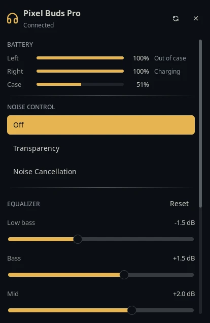

# Pixel Buds

Google Pixel Buds in the Noctalia bar. On the Pixel Buds Pro you get battery
for each bud and the case, noise control (Off / Transparency / Noise
Cancellation), the 5-band EQ, and the in-ear detection, Conversation Detection
and multipoint switches. Other Pixel Buds show their battery level.

Everything goes through [pbpctrl](https://github.com/qzed/pbpctrl) by
**qzed**, which speaks the buds' own control protocol (Maestro) over Bluetooth.

## Screenshots



## Plugin

| Field | Value |
| --- | --- |
| ID | `finoo125/pixel-buds` |
| Entries | Bar widget: `pixel-buds`; panel: `panel`; service: `service` |

## Supported models

| Model | Status | Features |
| --- | --- | --- |
| Pixel Buds Pro | Tested | Everything listed above |
| Pixel Buds Pro 2 | Experimental, untested | Everything above, plus the **Adaptive** noise mode |
| Other Pixel Buds (A-Series, 2a, …) | Experimental, untested | Battery only, from BlueZ |

Buds that advertise the Maestro service get full controls. Buds that do not
fall back to the single combined battery percentage BlueZ reports, since no
Linux tool can control them yet. If you own a Pro 2 or another model, please
open an issue saying what works and what does not.

## Requirements

- **`bluetoothctl`** (part of BlueZ), used to find the buds and check whether
  they are connected.
- **`pbpctrl`**, for the Pixel Buds Pro and Pro 2. It is not bundled; install
  it yourself:
  - Arch Linux: the [`pbpctrl`](https://aur.archlinux.org/packages/pbpctrl)
    AUR package.
  - Everything else, with cargo:

    ```sh
    cargo install pbpctrl --git https://github.com/qzed/pbpctrl/
    ```

    The build needs D-Bus headers, `pkg-config` and the protobuf compiler,
    including its bundled `.proto` files:
    - Fedora: `sudo dnf install cargo dbus-devel protobuf-compiler protobuf-devel`
    - Ubuntu/Debian: `sudo apt install cargo libdbus-1-dev pkg-config protobuf-compiler`

    On Fedora, leaving out `protobuf-devel` fails the build with
    `google/protobuf/empty.proto: File not found`.

    cargo installs to `~/.cargo/bin`. The plugin looks there automatically when
    `pbpctrl` is not on `PATH`.

Pair and connect the buds through your normal Bluetooth settings first.

**Battery-only models** need BlueZ to report earbud battery, which is still
experimental. Set this in `/etc/bluetooth/main.conf` and restart Bluetooth
(`sudo systemctl restart bluetooth`):

```ini
[General]
Experimental = true
```

## Usage

Add the **Pixel Buds** widget to a bar in Settings → Bar. It stays hidden
until the buds connect. It shows the battery of the emptier bud that is out of
the case, coloured when it is low or charging; the tooltip lists both buds,
the case and the current noise mode.

- **Left-click** opens the panel.
- **Right-click** cycles the noise mode (Off → Transparency → Noise
  Cancellation, plus Adaptive on the Pro 2).

Open the panel directly:

```sh
noctalia msg panel-toggle finoo125/pixel-buds:panel
```

The current noise mode can only be read while at least one bud is out of the
case. The case battery is reported while at least one bud sits in it, because
the case has no Bluetooth radio of its own.

## Settings

| Setting | Type | Default | Description |
| --- | --- | --- | --- |
| `pbpctrl_path` | `file` | empty | Path to `pbpctrl`. Empty searches `PATH`, then `~/.cargo/bin/pbpctrl`. |
| `device` | `string` | empty | Bluetooth address of the buds to use, e.g. `AA:BB:CC:DD:EE:FF`. Empty uses the first paired Pixel Buds. |
| `poll_interval` | `int` | `5` | Seconds between status checks (minimum 2). Settings and EQ are re-read every sixth check and whenever the panel opens. |
| `hide_when_disconnected` | `bool` | `true` | Widget setting. Hide the icon while the buds are not connected. |
| `show_percentage` | `bool` | `true` | Widget setting. Show the battery percentage next to the icon. |

## IPC

```sh
noctalia msg plugin finoo125/pixel-buds:service all <event>
```

| Event | Effect |
| --- | --- |
| `cycle-anc` | Switch to the next noise mode. |
| `anc-off`, `anc-aware`, `anc-active` | Switch to Off, Transparency or Noise Cancellation. |
| `refresh` | Re-read battery, noise mode and settings now. |

For example, a Hyprland keybind:

```ini
bind = SUPER, N, exec, noctalia msg plugin finoo125/pixel-buds:service all cycle-anc
```

## Notes

- **Processes spawned:** `bluetoothctl info <address>` on every check
  (preceded by `bluetoothctl devices` until the buds are found), and `pbpctrl -d <address> show runtime|get …|set …` while
  Maestro buds are connected. They run one at a time, because the buds accept a
  single control connection. Nothing is spawned for pbpctrl while the buds are
  disconnected, so polling never wakes them up.
- **No network access and no files written.** Settings changes go straight to
  the buds and persist there, just like changes made in the Pixel Buds app.
- pbpctrl sometimes logs `br-connection-aborted-by-remote` and retries. That
  is normal and only delays that one check by about a second.
- Debug: run the same commands by hand, e.g. `pbpctrl show runtime` and
  `bluetoothctl info <address>`.

## Credits

- [pbpctrl](https://github.com/qzed/pbpctrl) by qzed (MIT / Apache-2.0), which
  does all the Bluetooth work.
- Architecture adapted from
  [`harveywuk/airpods`](https://github.com/noctalia-dev/community-plugins/tree/main/airpods)
  (MIT).
